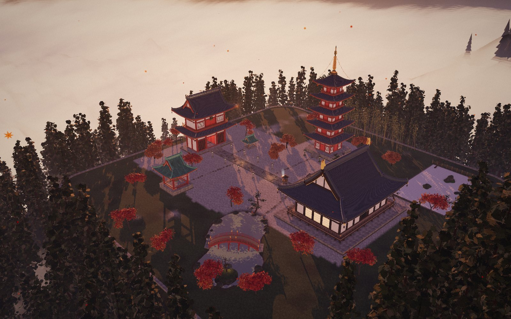

# New system: a design team for Claude Code

Three design skills, two MCP tools, and a skill that finds and installs more skills, all set up at project level. Clone the repo, open it in Claude Code,
and describe the website you want:

```
/build-website a site for a small coffee roaster in Lisbon that sells one single-origin bean a month
```

Claude picks an art direction, builds the page with real photographs, adds motion, critiques and
polishes it, then opens it in a real browser to test it. `CLAUDE.md` explains how the pieces divide the work.

To get more skills, say what you're working on ("find me a skill for writing changelogs", or run
`/find-skills`). Claude searches skills.sh, shows each match with its install count and author, and
installs the one you approve into this project.

## The demo site

`site/` is a landing page for this setup, built with it: Taste dealt the direction ("The sentence is the
layout") and gated it to 0 FAIL at 1440, 768 and 390; Emil Kowalski's rules set the motion; Impeccable
critiqued it (22/36, five priority issues) and its fixes were applied; Playwright MCP recorded the
click-through in `site/media/check.webm`. `site/proof/stock-page.html` is the deliberately generic
version of the same brief that the gate fails 19 times. Open `site/index.html`, or serve the folder:
`python3 -m http.server -d site`.

## Unkai-ji, a procedural 3D temple

**Live:** https://raycoding1-collab.github.io/New-system-/

`temple/` is an interactive 3D model of an original Japanese mountain temple above a sea of
clouds: a five-storey pagoda, main hall, two-storey gate, bell tower you can ring, dry garden,
koi pond and drum bridge, in four seasons and four times of day. It's built entirely in code
with three.js (vendored, no build step). Serve it with `python3 -m http.server -d temple` and
open the printed address. The exported, Draco-compressed model is `temple/model/unkai-ji.glb`.
Details are in [`temple/README.md`](temple/README.md).



## What's installed

| Piece | Source | Version | License |
| --- | --- | --- | --- |
| **Emil Kowalski's skills** (16): `emil-design-eng`, `animate`, `animate-expo`, `review-animations`, `improve-animations`, `find-animation-opportunities`, `remove-animations`, `animation-performance`, `animation-vocabulary`, `apple-design`, `write-swift`, `pick-ui-library`, `prototype`, `mobile-native`, `break-ui`, `ask-sonner` | [emilkowalski/skills](https://github.com/emilkowalski/skills) | `a81dbca` | MIT |
| **Impeccable** (1 skill, 24 commands, 4 subagents) | [pbakaus/impeccable](https://github.com/pbakaus/impeccable) | 4.8.0 (engine 0.1.18), `df3a4ab` | Apache-2.0 |
| **Taste** (`design-taste-frontend`) | [Leonxlnx/taste-skill](https://github.com/Leonxlnx/taste-skill) | 2.1.5, `12af471` | MIT |
| **Figma MCP** (remote server) | [figma/mcp-server-guide](https://github.com/figma/mcp-server-guide) | `https://mcp.figma.com/mcp` | Figma Developer Terms |
| **Playwright MCP** | [microsoft/playwright-mcp](https://github.com/microsoft/playwright-mcp) | `@playwright/mcp@0.0.83` | Apache-2.0 |
| **Find Skills** (`find-skills`): finds, vets and installs more skills from [skills.sh](https://skills.sh) | [vercel-labs/skills](https://github.com/vercel-labs/skills) | `92a9a34` | MIT |
| `/build-website` | this repo | — | — |

How each piece was installed:

- Emil's, Taste's and Find Skills: `npx skills add emilkowalski/skills --skill '*' --agent claude-code --copy`,
  `npx skills add https://github.com/Leonxlnx/taste-skill --skill design-taste-frontend --agent claude-code --copy` and
  `npx skills add vercel-labs/skills --skill find-skills --agent claude-code --copy`.
  The lockfile is `skills-lock.json`.
- Impeccable: copied from the upstream repo's tracked Claude Code build (`.claude/skills/impeccable`
  and `.claude/agents/impeccable-*.md`). These are the files `npx impeccable install --providers=claude
  --scope=project` places.

All skill files match upstream byte for byte. License texts are in `third_party/licenses/`.

## First run on your machine

1. **Requirements:** Node 22+ and Chrome, Edge or Chromium. The Taste inspector and Playwright both use
   the installed browser.
2. **Open the project in Claude Code.** When asked, approve the project MCP servers from `.mcp.json`
   (`figma`, `playwright`).
3. **Sign in to Figma:** run `/mcp`, choose `figma`, then **Authenticate**. The remote server needs a Dev
   or Full seat on a paid plan for normal use. Starter, View and Collab seats are limited to 6 tool calls a
   month. To use it, copy a link to a frame or layer in Figma and paste it into your prompt.
4. **Optional, Impeccable's design hook:** run `/impeccable hooks on`. It checks every UI file Claude
   edits for AI design tells and runs a deeper pass when Claude stops. It's off by default because it
   runs Impeccable's engine binary automatically. That binary downloads once from Impeccable's GitHub
   releases into `~/.impeccable/bin/`, checksum-verified. Without the hook, Impeccable asks for a single
   detector run at the end of a task instead.

As an alternative to `.mcp.json`, Figma's recommended Claude Code route is its plugin, which bundles the
same server with Figma's own skills: `claude plugin install figma@claude-plugins-official`. Use one
or the other, not both, or the Figma tools appear twice.

## Claude Code on the web

The setup also runs in cloud sessions, with these differences (also covered in `CLAUDE.md`):

- **Playwright MCP** switches to the container's Chromium and runs headless (`.claude/mcp/playwright.mjs`).
- **Taste's inspector** needs `CHROME_PATH="$PWD/.claude/bin/cloud-chromium"`. The container runs as root,
  so Chromium needs `--no-sandbox`. CLAUDE.md tells Claude to add this prefix.
- **Network:** the default policy blocks Figma and the photo archives. To use them, open the environment's
  settings (cloud environment menu in the session title bar → Edit → Network access). Then either pick a
  broader access level, or add these under Allowed domains:
  `mcp.figma.com`, `commons.wikimedia.org`, `upload.wikimedia.org`, `api.openverse.org`,
  `collectionapi.metmuseum.org`, `images.metmuseum.org`, `api.artic.edu`, `www.artic.edu`,
  `archive.org`, `images-api.nasa.gov`, `images-assets.nasa.gov`, and `skills.sh` for Find Skills search.
  See https://code.claude.com/docs/en/cloud-environments#network-access.
  Figma's OAuth sign-in also has to complete in the session. If it can't, connect Figma as a connector at
  https://claude.ai/customize/connectors and start a new session.

## Updating

```bash
npx skills update -p                  # Emil Kowalski's skills, Taste, Find Skills (reads skills-lock.json)
npx impeccable update                 # Impeccable
```

To move Playwright MCP to a newer release, change `VERSION` in `.claude/mcp/playwright.mjs`.
