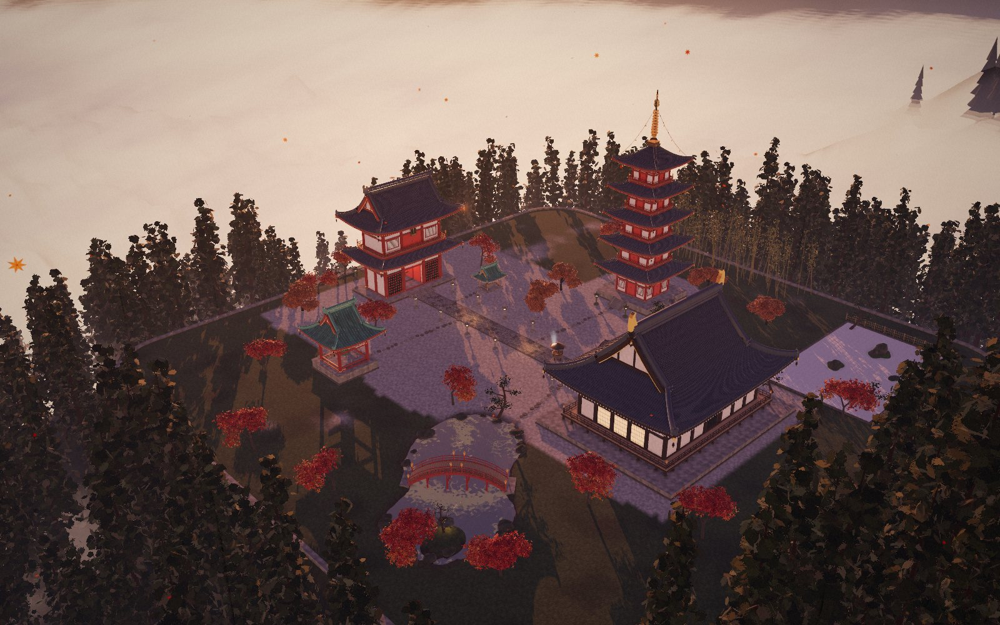
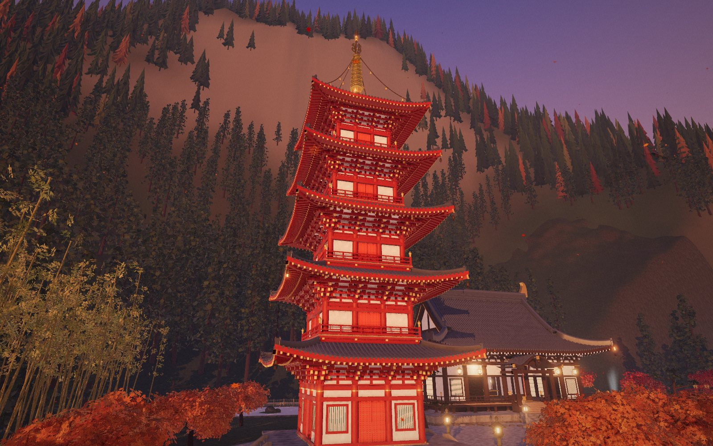
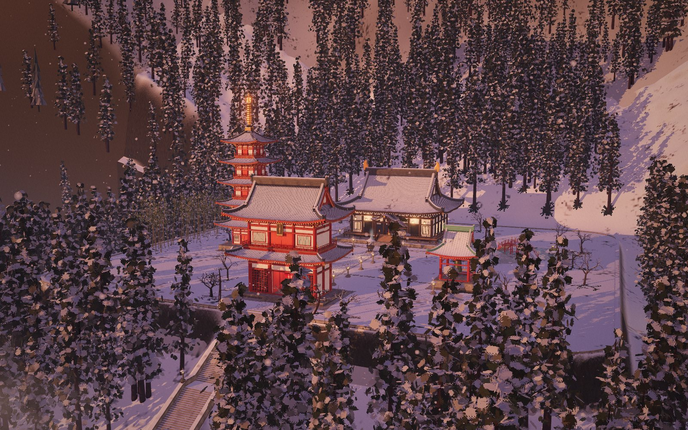
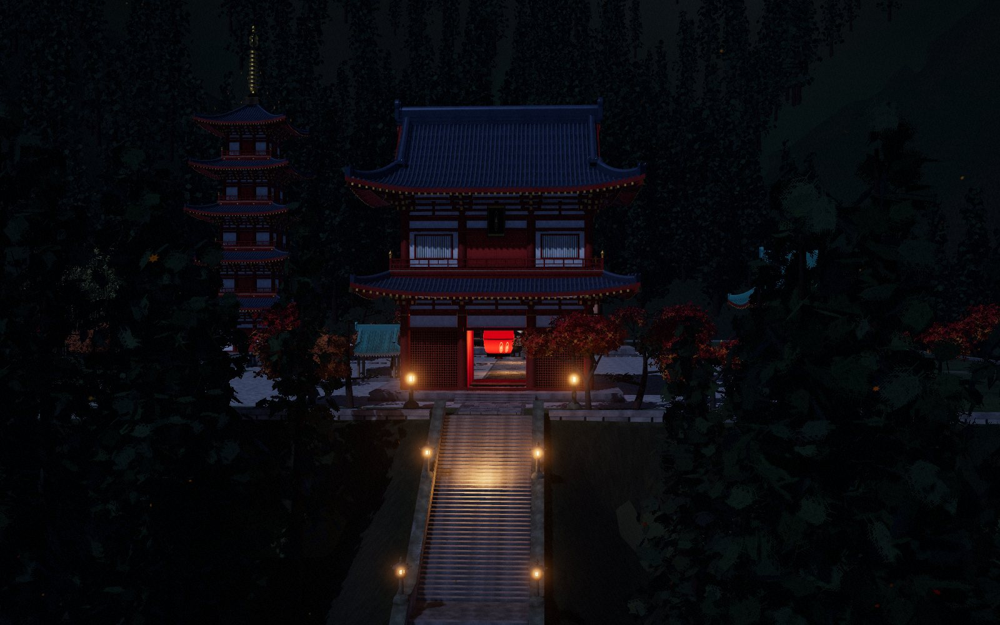
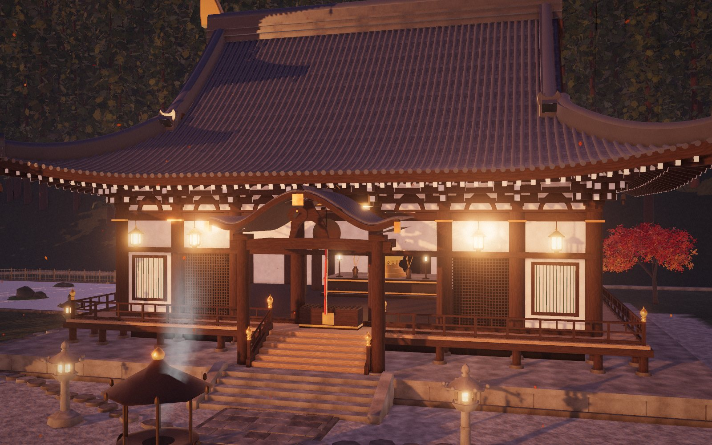
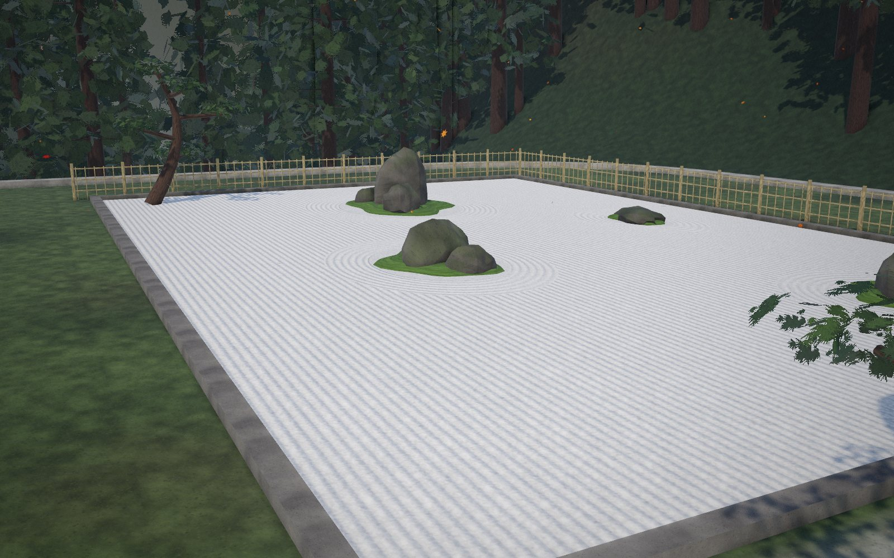
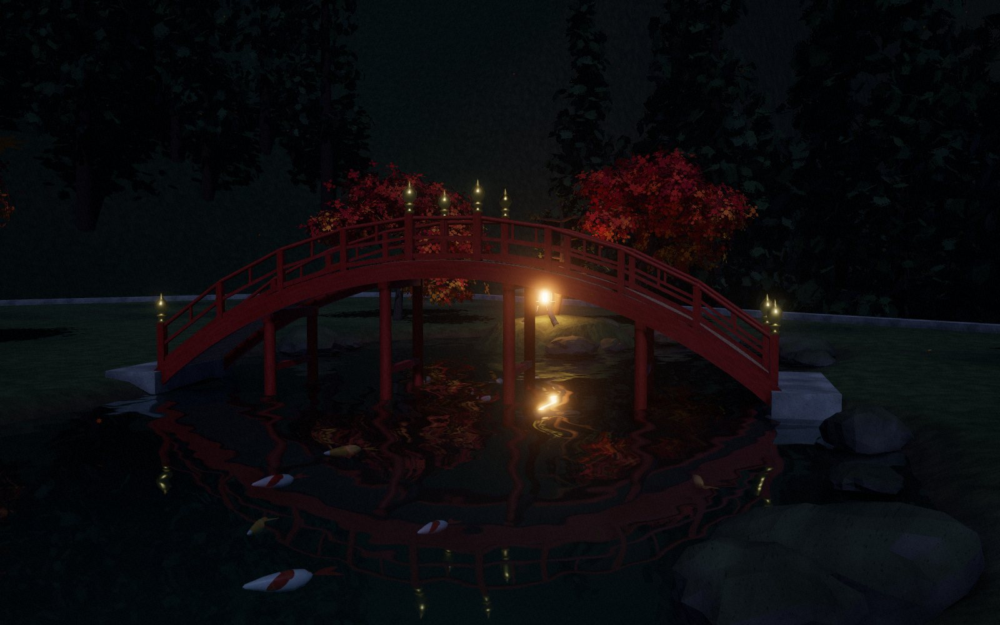

# Unkai-ji 雲海寺: a Japanese mountain temple above the sea of clouds

An interactive 3D model of an original Japanese temple, generated entirely in code with
[three.js](https://threejs.org). No meshes or images are downloaded: every roof tile, bracket,
leaf and gravel ripple is computed in the browser at load time (about 5 s). The temple and its
mountain-name plaque (霧峰山 Muhō-zan) are invented. The compound follows real Japanese temple
architecture, but it does not copy any existing temple.



| | |
| --- | --- |
|  |  |
|  |  |
|  |  |

## See it online

**https://raycoding1-collab.github.io/New-system-/** (GitHub Pages, served from this branch;
the root redirects to `temple/`, and `#pagoda`-style view links carry through).

## Run it

```bash
python3 -m http.server -d temple 8000
# then open http://localhost:8000
```

The page uses ES modules and an import map, so it has to be served over HTTP. Opening the file
directly (`file://`) won't work. three.js r187 is vendored in `vendor/`, so no install or build
step is needed.

**Controls:** drag to orbit · right-drag to pan · scroll to zoom · click the bell to ring it ·
<kbd>T</kbd> cycles the hour · <kbd>S</kbd> cycles the season. The side list (a scrolling row on
phones) flies the camera to nine viewpoints, and the markers open notes on each building.
**Tour** flies through the viewpoints by itself.

Viewpoints have links: `#overview`, `#front`, `#approach`, `#gate`, `#pagoda`, `#hondo`,
`#garden`, `#pond`, `#shoro` (for example `…/index.html#pagoda`). When working locally you can
also pass `?time=dawn|day|dusk|night`, `?season=spring|summer|autumn|winter`, `?clean` (hides
the interface) and `?quality=medium|low`.

### Quality and smoothness

Every visitor gets the full scene the gallery pictures were rendered from: ambient occlusion,
4K shadows, 4× multisampling, the whole forest and all twelve cloud layers. Smoothness comes
from savings you can't see:
- Shadows are only re-rendered when the light changes.
- The pond mirror draws only what can appear in it, and when the pond is small on screen it
  refreshes every other frame.
- Instances are merged so the scene draws in about 130 calls.
- Shaders compile behind the loading screen.
- Labels never force a page layout.

A dynamic-resolution loop watches the frame time and moves the pixel ratio between 1×, the
density the pictures were rendered at, and the screen's full sharpness (up to 2×). The effects
themselves never switch off. `?quality=` pins a setting.

### Hosting

On GitHub Pages the repository is served as static files: `/index.html` forwards to
`temple/`, and `.nojekyll` makes Pages serve every file as-is. Turn it on under **Settings →
Pages → Build and deployment**: Source *Deploy from a branch*, then choose this branch and
`/ (root)`.

`hosted.html` is the same page with three.js loaded from jsDelivr instead of `vendor/`, for
hosts whose content policy only allows scripts from known CDNs, such as Claude artifacts.
Publish it as the site's `index.html` together with `styles.css` and `src/`. The Export button
works in both versions. A normal browser downloads the `.glb` directly. Inside a Claude artifact
the host's download prompt delivers it as a `.zip`, because that sandbox doesn't allow `.glb`
downloads.

## The 3D model file

`model/unkai-ji.glb` (15.7 MB) is the exported model: buildings, terrace, garden, pond, bridge,
bell and the hand-placed trees, with materials and textures. It's Draco-compressed, which Blender,
three.js (`DRACOLoader`), Babylon.js and most glTF viewers read. It contains about 1.5 million
vertices, 64 PBR materials and 49 textures. To get an uncompressed copy in the season and hour
you're looking at, click **Export .glb** in the viewer. That file is about 76 MB.

## What's in the compound

| Building | Notes |
| --- | --- |
| **Gojū-no-tō** 五重塔, five-storey pagoda | Five storeys tapering to two-thirds width. Three-stepped *mitesaki* bracket sets on every column. Railed balconies on bracketed skirts. Twenty wind bells. Bronze *sōrin* spire (dew basin, inverted bowl, lotus, nine rings with bells, openwork water-flame, dragon car, jewel), with chains and bells running down to the top roof. About 38 m tall. |
| **Hondō** 本堂, main hall | 7 × 5 bays on a granite platform, raised timber floor, railed veranda. Hip-and-gable (*irimoya*) roof with gilt *shibi* ridge finials and a plastered gable with bargeboards and a *gegyo* ornament. A *karahafu* step canopy over the stair. The central bays open onto a gilt seated Buddha on a three-tier lotus throne before a flame-edged mandorla, under a coffered ceiling and hanging canopy. Shōji side walls glow at night. |
| **Sanmon** 山門, mountain gate | Two-storey vermilion *rōmon*. Lattice-screened side bays, studded doors swung open, a great red *chōchin* lantern bearing the temple crest, a railed balcony, and a vertical plaque with the mountain name. |
| **Shōrō** 鐘楼, bell tower | Open pavilion with a green copper roof. The bonshō has nipple panels, crossing bands, lotus striking seats and a dragon loop. Clicking it swings the log striker, rocks the bell and plays a synthesised strike. |
| **Temizuya** 手水舎 | Copper-roofed purification pavilion with a granite basin, bamboo ladles and a bamboo spout. |
| **Karesansui** 枯山水 | Dry garden. The rake pattern is computed from the stones, with ripples ringing each group and straight furrows between. Moss islands and a bamboo *yotsume-gaki* fence. |
| **Pond** | Two-lobed koi pond with a live mirror reflection, eleven koi (kohaku, sanke, ogon, showa), a vermilion *taiko-bashi* drum bridge over the waist, an island with a *yukimi-dōrō*, and granite bank boulders. |
| **Site** | *Ishigaki* stone retaining walls, a granite-paved approach with *kasuga-dōrō* lanterns, a bronze incense burner with rising smoke, and a stair of about 250 steps descending into the sea of clouds. Around it: maples, cherries, cloud-pruned pines, cedars, a bamboo grove, a forest on the slopes, distant ridges and a snow-capped volcano. |

## Seasons and hours

- **Spring:** cherry blossom and falling petals.
- **Summer:** deep greens, and fireflies after dark.
- **Autumn:** crimson-to-gold maples and tumbling leaves.
- **Winter:** bare maples, falling snow, and snow on every upward surface. A top-down height capture keeps snow from forming under the eaves or inside the halls.

Each of dawn, day, dusk and night sets its own sun or moon, sky gradient, height fog, cloud
colours, exposure and lantern level. Switching eases between them over 2.4 s.

## How it's built

```
src/
  main.js             renderer, lights, time/season transitions, camera, bell, export
  layout.js           site plan
  arch/roof.js        the roof generator: hip, hip-and-gable and pyramidal roofs from one
                      surface function, with the concave profile, upturned corners,
                      round-tile rows, two rafter layers, hip rafters, ridges, gables, bells
  arch/body.js        a storey: columns, beams, wall bays, bracket sets, kokabe panels
  arch/parts.js       bracket sets, railings and giboshi, stairs, platforms, doors, windows
  build/*.js          pagoda, main hall (+ karahafu, Buddha), gate, bell tower, props
  nature/*.js         terrain and walls, trees and seasons, dry garden, pond and koi
  env/*.js            sky, sea of clouds, particles, time/season presets
  fx/post.js          GTAO, bloom, filmic output, vignette and grain
  fx/bell.js          the bell's synthesised voice (Web Audio)
  lib/                seeded noise, procedural textures, materials, shader patches
```

Every building writes into a geometry builder that merges parts by material, so the compound
draws in a few dozen calls despite about 2.9 million triangles. Shared shader patches add
height fog, winter snow and foliage wind to every material.

Motion respects `prefers-reduced-motion`: the camera cuts instead of flying, and particles thin
out and slow down.

three.js is MIT-licensed. Its licence is in `vendor/three/LICENSE` and
`../third_party/licenses/three.js.LICENSE`.
